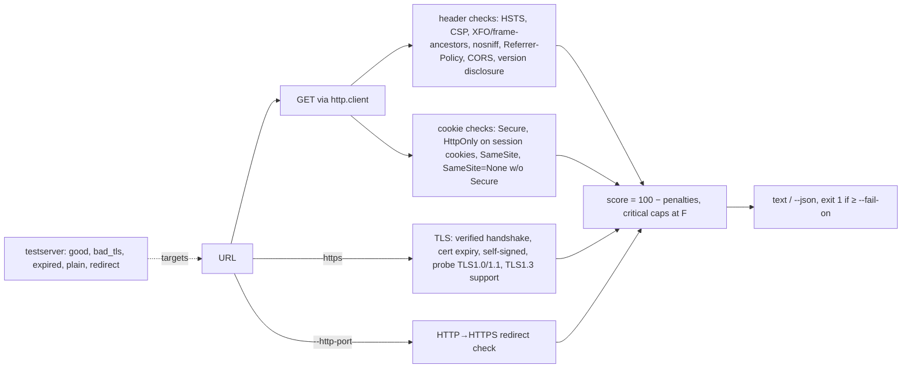

# webvuln-scanner: CLI for security headers, cookies and TLS

> **Lab project.** It's only tested against local lab servers I wrote (`testserver/`) and my own `secure-shortener`. Scan only sites you own or are authorised to test. Stdlib-only scanner.

## Problem
Most web findings in junior VAPT reports are configuration issues:
- missing HSTS/CSP
- session cookies without `Secure`/`HttpOnly`
- TLS 1.0 still enabled
- expired or self-signed certs
- `Server: Apache/2.2.15`

They're easy to check but easy to miss by hand. This CLI does those checks in one pass, gives a score and grade, and exits non-zero so it can gate a CI pipeline.

## Architecture


## Run
```bash
python3 -m venv .venv && .venv/bin/pip install -r requirements-dev.txt
./testserver/make_certs.sh            # throwaway lab CA + good/self-signed/expired certs
.venv/bin/pytest -q                   # starts the lab servers in-process
python run_lab.py                     # scans all 4 lab targets → results/lab_scan.{txt,json}
python -m webscan.cli https://your-site.example --json --fail-on medium
docker build -t webvuln-scanner . && docker run --rm webvuln-scanner https://your-site.example
```

## Results (actual runs, 2026-10-11, `results/`)
| Lab target | Config | Grade | Key findings |
|---|---|---|---|
| good | CA-signed cert, TLS ≥1.2, full headers, `Secure; HttpOnly; SameSite=Lax` cookie, HTTP→HTTPS 301 | **A (100)** | none. Negotiated TLSv1.3 / TLS_AES_256_GCM_SHA384 |
| bad_tls | self-signed, TLS 1.0–1.2 at SECLEVEL=0, Apache/2.2.15 + PHP/5.4.16, `ACAO *` + credentials, weak cookies | **F (0)** | 18 findings incl. **TLSv1.0 and TLSv1.1 accepted**, self-signed, CORS, PHPSESSID without Secure/HttpOnly |
| expired | cert valid Jan–Feb 2025 | **F (39)** | CRITICAL certificate expired |
| plain | HTTP only + bad headers/cookies | **F (0)** | 14 findings incl. NO_TLS |
| my secure-shortener (uvicorn, lab HTTP) | | **B (85)** | only NO_TLS. All header checks pass (`results/shortener_scan.txt`) |

pytest: **8 passed**. The 21 warnings are Python's `DeprecationWarning` for deliberately enabling TLS 1.0 on the bad lab server.

## Limitations
- Detection is checked only against my own lab servers, where I know the ground truth. It hasn't been benchmarked against Mozilla Observatory/testssl.sh on real sites.
- TLS probing depends on the *local* OpenSSL. If the client OpenSSL can't do TLS 1.0 even at SECLEVEL=0, legacy-protocol findings become false negatives. No cipher-suite enumeration, no SSLv3, no certificate-chain or OCSP/CT checks.
- Single GET to one path. Cookies set after login or on other paths aren't seen. No crawling, no JS rendering.
- CSP analysis is shallow (unsafe-inline/wildcard only). There's no nonce/hash or `strict-dynamic` reasoning like Google's CSP Evaluator.
- The scoring weights are my own choice. The grade is a heuristic, not a standard.

## Sources
- OWASP Secure Headers Project: https://owasp.org/www-project-secure-headers/
- OWASP WSTG: Testing for Weak TLS (WSTG-CRYP-01), Cookie Attributes (WSTG-SESS-02): https://owasp.org/www-project-web-security-testing-guide/
- RFC 8996, Deprecating TLS 1.0 and TLS 1.1: https://www.rfc-editor.org/rfc/rfc8996
- RFC 6797 (HSTS), RFC 6265bis (cookies, SameSite): https://www.rfc-editor.org/rfc/rfc6797
- MDN, Set-Cookie and SameSite=None requires Secure: https://developer.mozilla.org/en-US/docs/Web/HTTP/Headers/Set-Cookie
- Mozilla Observatory scoring methodology: https://github.com/mozilla/http-observatory/blob/main/httpobs/docs/scoring.md
- Python `ssl` docs (TLSVersion, VERIFY_X509_STRICT default in 3.13): https://docs.python.org/3/library/ssl.html

## Related work

This is my own implementation. Ideas came from Mozilla Observatory, securityheaders.com and testssl.sh.
